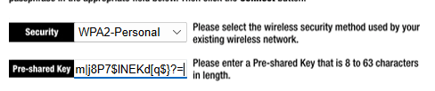
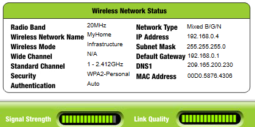
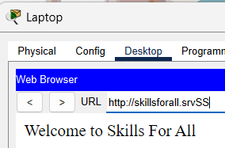
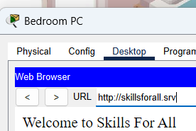

# Lab 01 : Configuration de base d'un routeur et des clients sans fil

* **Date** : 22/11/2026
* **Outil** : Cisco Packet Tracer
* **Objectif** : Connecter les appareils, configurer le routeur sans fil, configurer l'adressage IP, tester la connectivité puis appliquer les mesures de sécurité de base.

---

* Equipements utilisés : 
* Plan d'adressasge IP : 

## Etape 1 : Connection des cables coaxiaux et réseaux
* Connecter le répartiteur au modem avec un câble coaxial en branchant ce dernier dans le port 0 du modem et dans le port coaxial 1 du répartiteur.
* Connecter le port coaxial 2 du répartiteur au port 0 de la TV.
* Vérifier la connection à la TV en l'allumant.
* Connecter le modem au routeur sans fil domestique avec un câble droit en cuivre en branchant ce dernier au port Internet du routeur et le port 1 du modem.
* Connecter le PC du bureau au routeur avec un câble droit en cuivre en branchant ce dernier au port FastEthernet0 du PC et au port GigabitEthernet1 du routeur.
* Répéter les deux étapes précédentes pour le PC de la chambre.

## Etape 2 : Configuration du routeur
* Modifier le nombre maximum d'utilisateur de 50 à 10 
* Modifier le mot de passe constructeur par un mot de passe robuste conforme aux recommandations de l'ANSSI (longueur > 16 caractères, haute entropie et unicité) afin de prévenir les attaques par force brute ou dictionnaire. Ici : Qs;-Y7nPJF9|oY9j;F&3h3
* L'interface de ce modèle de routeur domestique ne permet pas de modifier l'identifiant admin.

## Etape 3 : Configuration du réseau sans fil
* Personnaliser le SSID de "default" à "MyHome".
* Activer la diffusion du SSID afin que les clients puissent le voir et s'y connecter.
* Activer le WPA2 Personal (niveau de sécurité maximal de ce routeur) pour chiffrer les données circulant entre les appareils et le routeur Wi-Fi (encryption AES) et d'empêcher les personnes n'ayant pas le mot de passe de se connecter au réseau.
* Ajouter un mot passe robuste différent de celui du routeur, ici : _cE0m|j8P7$lNEKd[q$}?=

## Etape 4 : Adressage IP et test de connectivité
* Connectez l'ordinateur au réseau sans fil en utilisant le mot de passe définit précédemment.

* Vérifier le statut du réseau sans fil.

* Vérifier la connexion à Internet de l'ordinateur portable en allant sur une page Web.

* Répéter l'étape précedente pour l'ordinateur de bureau.

* Définir la passerelle sur DHCP pour l'ordinateur de la chambre afin d'attribuer automatiquement une adresse IP et les paramètres de connexion.
* Vérifier la connexion à Internet de l'ordinateur de la chambre en allant sur une page Web.

