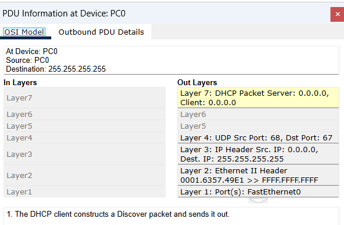
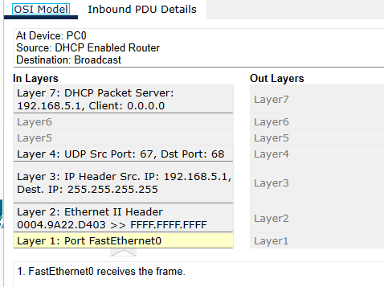
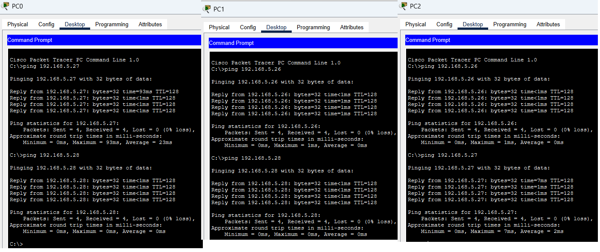
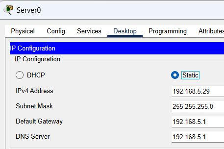
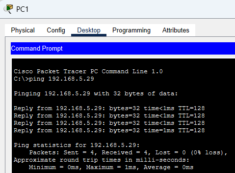
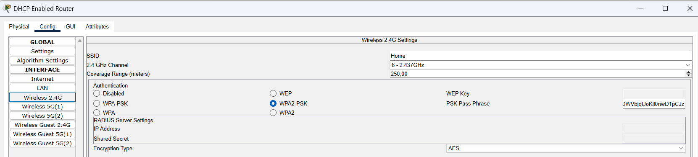
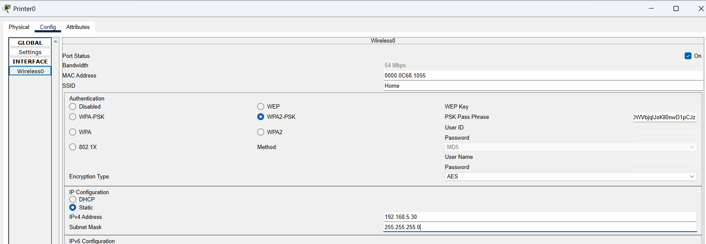
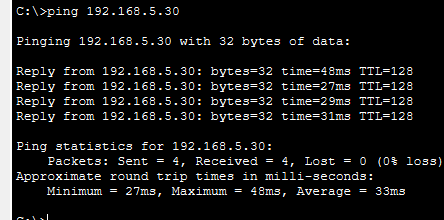

# Lab 02 : Configuration DHCP, IPv4 statique et inspection de paquets 
## 1. Informations générales 
* **Date** : 23/11/2026
* **Outil** : Cisco Packet Tracer (.pka du module 11 de "Notions de base sur les réseaux")
* **Objectifs** : 
    * Définir le paramètre DHCP sur une plage réseau spécifique.
    * Configurer 3 clients pour obtenir leur adresse via DHCP.
    * Vérifier la connectivité LAN de chaque PC au réseau.
    * (Ajout personnel d'exercices) Ajouter et configurer un serveur câblé et une imprimante WiFi en IPv4 statique.
    * (Ajout) Vérifier la connectivité LAN de l'imprimante et le serveur au réseau.
---

## 2. Étapes 
## Etape 1 : Activer le protocole DHCP sur PC0 et configurer le routeur
Une fois les 3 PCs connectés par câble au routeur :
* Activer le protocole DHCP du PC0 dans IP Configuration ce qui envoi un paquet découverte en diffusion (broadcast).

Discover packet :  
  
Acknowledgement packet :  
  
(passerelle par défaut est 192.168.5.1 car screenshot ultérieur)
* Accéder au routeur à partir de l'adresse IP de la passerelle par défaut et d'un navigateur WEB.  
* Modifier l'adresse IP du routeur de 192.168.0.1 à 192.168.5.1 puis sauvegarder et relancer la requête DHCP du PC0.
* Modifier la plage d'adresse DHCP passant de 192.168.5.100 à 192.168.5.26
* Modifier le nombre maximum d'utilisateurs à 75 et sauvegarder, puis relancer la requête DHCP du PC0.
* Activer DHCP sur PC1 et PC2.
* Vérifier la connectivité entre PCs avec ping "adresse IP des autres PC"
  

## 3. Exercices supplémentaires personnels
Ajouter un serveur et une imprimante wifi en IPv4 statique (ajout personnel à l'exercice CISCO)
* Ajouter un serveur en connection câblé avec le routeur.
* Configurer l'IP statique du serveur.  
  
* Vérifier la connectivité du serveur à partir d'un PC.  
  
* Activer le Wi-Fi 2,4 Ghz en activant le WPA2-PSK et le mot de passe suivant (l'imprimante n'accepte que des caractères ASCII) :
```console
DOWVbjqIJoKil0nwD1pCJz
``` 
  
* Retirer le module PT-HOST-NM-1CE de l'imprimante (Ethernet uniquement).
* Ajouter le module PT-HOST-NM-1W (Wifi disponible).
* Configurer le wifi et l'adresse IPv4 statique.  
  
* Vérifier la connection entre PC et imprimante.  
  

## 4. Bilan 
Les objectifs ont été atteint sans encombre. L'adresse IP automatique donné par le DHCP au PC0 était décroissant au départ .100 au lieu de .26, mais en relançant ça c'est remis en ordre croissant. L'inspection des paquets en mode simulation à révélé l'ensemble du protocole DHCP (discover, offer, request et ACK) entre périphérique et routeur.