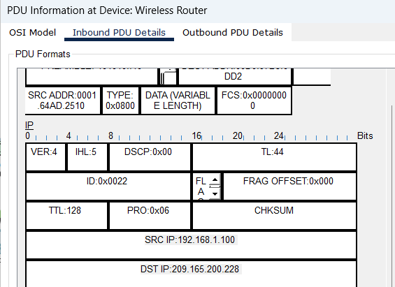
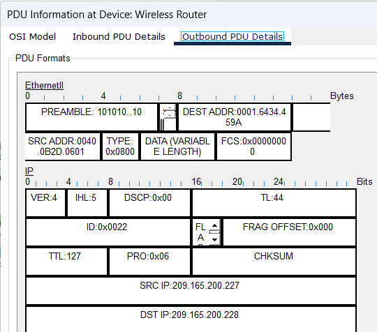

# Lab 03 : Analyse de paquet vers un réseau local et un réseau distant
## 1. Informations générales 
* **Date** : 24/11/2026
* **Outil** : Cisco Packet Tracer (.pka du module 12 et 13 de "Notions de base sur les réseaux")
* **Objectifs** : 
    * Examiner la configuration NAT sur un routeur sans fil
    * Analyser le trafic dans un réseau local
    * Analyser le trafic dans un réseau distant
---

## 2. Étapes
### Etape 1 : Analyser les en-têtes des paquets envoyés entre un ordinateur et un serveur Web.

Paquet d'entré d'un ordinateur vers le routeur :     

Paquet de sortie depuis le routeur vers site web :  

* On voit bien l'adresse IPv4 privé 192.168.1.100 traduit en adresse IPv4 publique 209.165.200.227 à partir d'une table NAT dans le routeur.

### Etape 2 : Identifier les adresses IP et MAC d'un réseau local
* ping 172.16.31.3 à partir de 172.16.31.2 
* Inspecter le paquet à chaque étape.

Paquet d'un ping local envoyé :  

| Nbr | At Device         | Src MAC        | Dest. MAC      | Src IPv4    | Dest IPv4   |
| --- | ----------------- | -------------- | -------------- | ----------- | ----------- |
| 1   | 172.16.31.3       | 0060:7036:2849 | 000C:85CC:1DA7 | 172.16.31.3 | 172.16.31.2 |
| 2   | Switch 2          | 0060:7036:2849 | 000C:85CC:1DA7 | -           | -           |
| 3   | 172.16.31.2 (in)  | 0060:7036:2849 | 000C:85CC:1DA7 | 172.16.31.3 | 172.16.31.2 |

Paquet du ping local retour :  

| Nbr | At Device         | Src MAC        | Dest. MAC      | Src IPv4    | Dest IPv4   |
| --- | ----------------- | -------------- | -------------- | ----------- | ----------- |
| 1   | 172.16.31.3 (out) | 000C:85CC:1DA7 | 0060:7036:2849 | 172.16.31.2 | 172.16.31.3 |
| 2   | Switch 2          | 000C:85CC:1DA7 | 0060:7036:2849 | -           | -           |
| 3   | 172.16.31.3 (in)  | 000C:85CC:1DA7 | 0060:7036:2849 | 172.16.31.2 | 172.16.31.3 |

* On voit bien l'inversion de l'adresse MAC et IP source par celle de destination lors de l'envoi d'une réponse ping.

### Etape 3 : Identifier les adresses IP et MAC d'un réseau distant

* Ping vers un ordinateur d'un réseau distant :  

| Step | At Device       | Src MAC        | Dest. MAC      | Src IPv4    | Dest IPv4  |
| --- | --------------- | -------------- | -------------- | ----------- | ---------- |
| 1   | 172.16.31.3     | 0060.7036.2849 | 00D0:BA8E:741A | 172.16.31.3 | 10.10.10.2 |
| 2   | Switch 2        | 0060.7036.2849 | 00D0:BA8E:741A | -           | -          |
| 3   | Router (in)     | 0060.7036.2849 | 00D0:BA8E:741A | 172.16.31.3 | 10.10.10.2 |
| 4   | Router (out)    | 00D0:588C:2401 | 0060.2F84:4AB6 | 172.16.31.3 | 10.10.10.2 |
| 5   | Switch 1        | 00D0:588C:2401 | 0060.2F84:4AB6 | -           | -          |
| 6   | Access Point    | -              | -              | -           | -          |
| 7   | 10.10.10.2 (in) | 00D0:588C:2401 | 0060.2F84:4AB6 | 172.16.31.3 | 10.10.10.2 |

* A l'étape 4  on voit bien la ré-encapsulation du paquet dans une nouvelle trame par le changement d'adresse MAC source.  
* A l'étape 6 il y a eu une ré-encapsulation d'une trame Ethernet en trame Wi-Fi.

Réponse écho :  

| Step | At Device        | Src MAC        | Dest. MAC      | Src IPv4    | Dest IPv4   |
| --- | ---------------- | -------------- | -------------- | ----------- | ----------- |
| 1   | 10.10.10.2 (out) | 0060.2F84:4AB6 | 00D0:588C:2401 | 10.10.10.2  | 172.16.31.3 |
| 2   | Access Point     | -              | -              | -           | -           |
| 3   | Switch 1         | 0060.2F84:4AB6 | 00D0:588C:2401 | -           | -           |
| 4   | Router (in)      | 0060.2F84:4AB6 | 00D0:588C:2401 | 10.10.10.2  | 172.16.31.3 |
| 5   | Router (out)     | 00D0:BA8E:741A | 0060.7036.2849 | 172.16.31.3 | 10.10.10.2  |
| 6   | Switch 2         | 00D0:BA8E:741A | 0060.7036.2849 | -           | -           |
| 7   | 172.16.31.3      | 00D0:BA8E:741A | 0060.7036.2849 | 172.16.31.3 | 10.10.10.2  |

* A l'étape 2 il y a eu une ré-encapsulation d'une trame Wi-Fi en trame Ethernet.

## 3. Bilan
Les analyses de paquets ont bien révélé le trajet suivi par un paquet de sa source à une destination dans un réseau local et dans un réseau distant, à travers des périphériques intermédiaires tels que switch, routeur et point d'accès. On y voit aussi les ré-encapsulations au niveau du routeur (changement de trame, d'adresse MAC) et du point d'accès (changement de trame Ethernet/Wi-Fi).