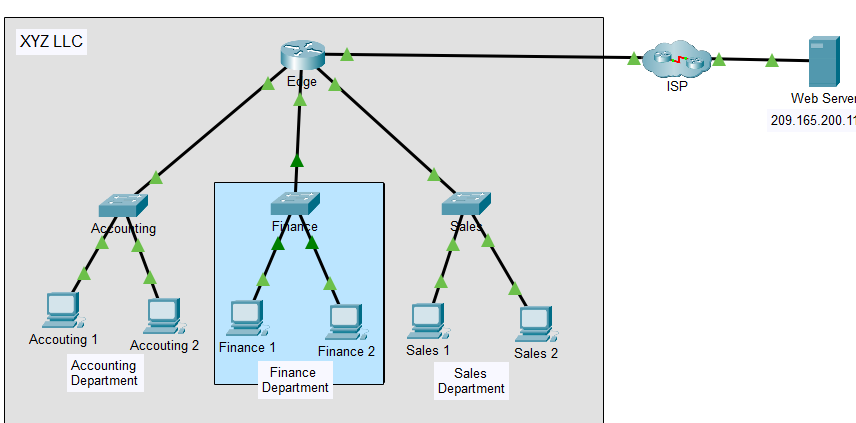
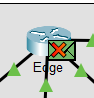
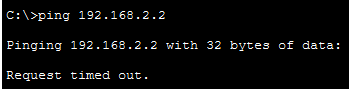
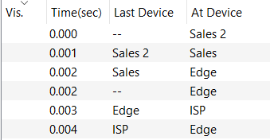
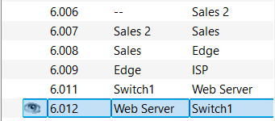
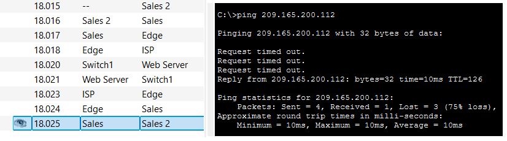

# Lab 04 : Observation et analyse de trafic dans un LAN non routé puis routé

## 1. Informations générales
* **Date** : 25/11/2026
* **Outil** : Cisco Packet Tracer (.pka du module 14 de "Notions de base sur les réseaux")
* **Objectifs** : 
    * [Observer le flux de trafic dans un LAN non routé.]( #etape-1--observation-et-analyse-de-flux-de-trafic-dans-un-lan-non-routé)
    * [Reconfigurer le réseau pour router entre les LAN](#etape-2--reconfiguration-du-réseau-pour-acheminer-entre-les-lan)
    * [Observer le flux de trafic dans le réseau routé.](#etape-3--observation-et-analyse-du-flux-de-trafic-dans-le-réseau-avec-un-routeur)
* [Bilan](#3-bilan)

---
## 2. Étapes 
### Etape 1 : Observation et analyse de flux de trafic dans un LAN non routé
  
*Figure 1 : Topologie du réseau LAN sans routeur.*
* Vérifier qu'il n'y a pas d'adresse MAC dans le cache ARP de Sales 1 avec la commande arp -a (arp -d pour les supprimer si il y en a)
* Ping du périphérique Sales 1 `192.168.1.7` à partir de Sales 2 `192.168.1.5` en mode simulation.  

| At Device  | Src MAC        | Dest. MAC      | Src IPv4    | Dest. IPv4  |
| ---------- | -------------- | -------------- | ----------- | ----------- |
| Sales (in) | 00E0.8FA9.B373 | FFFF.FFFF.FFFF | 192.168.1.5 | 192.168.1.7 |
* On voit bien la requête ARP de Sales 2 avec l'adresse de destination MAC `FFFF.FFFF.FFFF` (adresse de diffusion) depuis l'adresse MAC de Sales 2 afin de connaître l'adresse MAC associé à l'adresse IPv4 (Sales 2) qu'on a ping (absent de la table ARP).
* Actuellement l'ensemble du réseau (Accounting, Finance et Sales) reçoit la requête ARP, ce qui réduit son efficacité dû au nombres de requête ARP diffusées (150 appareils connectés en LAN) et ce qui réduit sa sécurité.
* Une fois la réponse ARP reçu à Sales 2, le ping est envoyé à Sales 1.

---
### Etape 2 : Reconfiguration du réseau pour acheminer entre les LAN
* Connecter les switchs Finance et Sales au routeur Edge.
* Entrez la commande ipconfig /renew sur chacun des périphériques de Finance et Sale afin d'accélérer le processus d'obtention de nouvelle adresse IP à partir du protocole DHCP.
* Le réseau Finance est attribué le réseau IPv4 `192.168.168.2.0/24` et le réseau Sales est attribué le réseau `IPv4 192.168.3.0/24`
  
*Figure 2 : Topologie du réseau LAN avec un routeur*

----
### Etape 3 : Observation et analyse du flux de trafic dans le réseau avec un routeur
### 3.1. Observer et analyser le flux de trafic entre les réseaux LAN
* Vérifier qu'il n'y a pas d'adresse MAC dans le cache ARP de Sales 1 avec la commande arp -a (arp -d pour les supprimer si il y en a)
#### 3.1.1. Dans le même domaine de diffusion (Sale)
* Ping Sales 1 `192.168.3.2` à partir de Sales 2 `192.168.3.3` en mode simulation.  
  
*Figure 3 : trame de diffusion rejetée.*
* On voit bien que la requête ARP (diffusion) est rejetée à partir du routeur. Seul les périphériques de Sales reçoivent la diffusion.

#### 3.1.2. Dans un domaine de diffusion différent (Finance)
* Ping Finance 1 `192.168.2.2` à partir de Sales 2 `192.168.3.3` en mode simulation.
* Sales 1 calcul qu'il n'est pas sur le même réseau que l'adresse IPv4 de destination à partir de l'adresse réseau. Ainsi il doit passer par sa passerelle par défaut dont il connaît l'adresse IPv4 `192.168.3.1` mais pas l'adresse MAC comme sa table ARP est vide.
* Sales 1 envoi une requête ARP pour connaître cette adresse MAC en envoyant une trame dont l'adresse de destination IPv4 est sa passerelle par défaut et l'adresse de destination MAC est une adresse de diffusion `FFFF.FFFF.FFFF`.
* Une fois que le routeur reçoit cette trame, il renvoie à Sales 2 l'adresse MAC de l'interface (port) qui à reçu la trame `00E0.F994.C336` afin qu'il l'associe dans sa table ARP.
* Ensuite, Sales 2 envoie une trame ICMP à l'adresse de destination IPv4 de Finance 1 et avec l'adresse de destination MAC de la passerelle par défaut récupéré.
* Quand le routeur reçoit cette trame, il regarde dans sa table de routage pour identifier l'interface de sortie (port) qui correspond au réseau de destination `192.16.2.0`
* Le routeur reconstruit une nouvelle trame Ethernet et regarde dans sa propre table ARP s'il connaît l'adresse MAC du PC de destination. Ici il ne la connaît pas.
* Le routeur envoie une requête ARP au réseau de diffusion Finance. Finance 1 envoie son adresse MAC au routeur `00D0.972C.9DA6` afin qu'il l'ajoute à sa table ARP.
* Le 1er ping time out.  

* Sales 2 renvoie un ping et cette fois-ci, le routeur connaît l'adresse MAC de Finance 1 et lui envoie directement le ping, qui va renvoyer un ping à Sales 2. Ce dernier le reçoit bien.  

### 3.2. Observer et analyser le flux de trafic entre le réseau LAN et Internet
* Ping le serveur Web `209.165.200.112`, à partir de Sales 2 `192.168.3.3`
#### 3.2.1. Dans le parcours du 1er ping :
* Le routeur demande en diffusion avec un paquet ARP : "Quelle est l'adresse MAC de l'adresse de destination IPv4 209.165.200.112 ?"
L'ISP lui répond : "cette adresse est associé à l'adresse MAC 00D0.BAE0.A476". Puisque l'ISP le possède dans sa table de routage, il renvoie l'adresse MAC de l'interface par laquelle le message est arrivé.  

* Le 1er ping time out.

#### 3.2.2. Dans le parcours du 2nd ping :
* L'ISP demande en diffusion avec un paquet ARP : "Quelle est l'adresse MAC de l'adresse de destination IPv4 `209.165.200.112` ?" 
Le serveur web lui répond : "cette adresse est associé à l'adresse MAC `0006.2AED.806E`".  

* Le 2nd ping time out.

#### 3.2.3. Dans le parcours du 3ème ping :
* Le ping est bien reçu par le serveur Web mais l'ISP demande en diffusion avec un paquet ARP : "Quelle est l'adresse MAC de l'adresse de destination IPv4 `192.168.3.3` ?" Puisqu'il ne la pas dans sa table ARP. Il a le routeur mais pas Sales 2.  

* Le 3ème ping time out.

#### 3.2.4. Dans le parcours du 4ème ping :
* Le ping est bien reçu par le serveur Web puis renvoyé et reçu par Sales 2 étant donné que les adresses de destination MAC et IPv4 sont connues par les routeurs dans les deux sens.
  

---
## 3. Bilan
L'exercice à permis une bien meilleur compréhension des communications entre périphériques hôtes et intermédiaires, notamment avec le protocole ARP, la table de routage et la table ARP. 

Il y avait une confusion importante lors du 3ème ping qui à time out, nécessitant de bien observer pour comprendre que l'ISP ne connaissait pas l'adresse MAC de l'adresse de destination de Sales 2. Je pensai que comme il connaissait l'adresse MAC du routeur Eedge il pouvait l'envoyer. 

Ce qui m'a aussi perturbé, c'est que l'adresse IPv4 de destination était une adresse privée `192.168.0.0`, au lieu de publique, alors que c'est sur internet.

---
