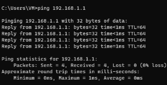
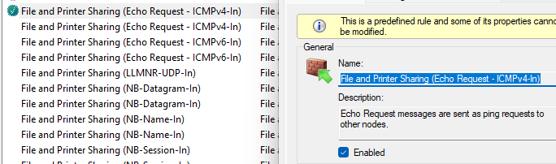
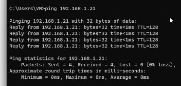
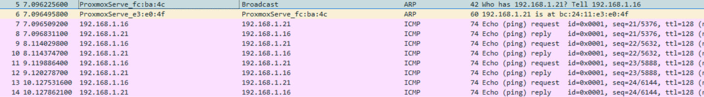
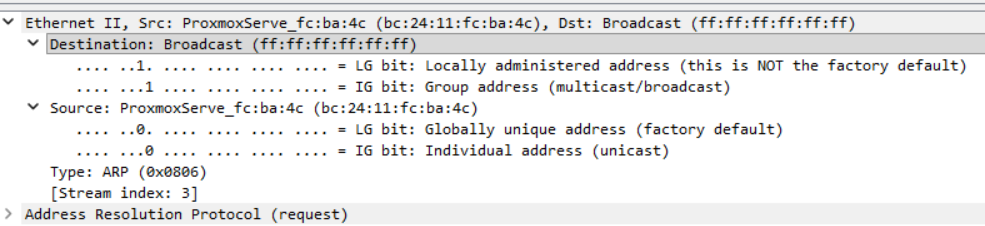
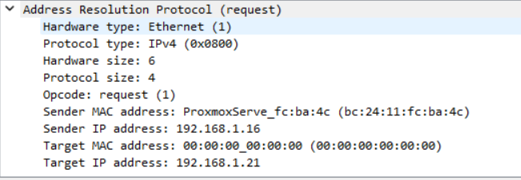
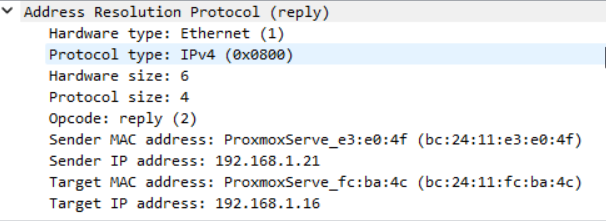
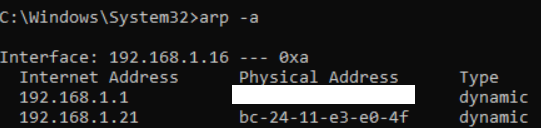
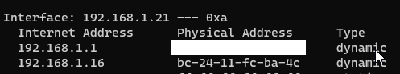

# Lab05 : Analyse de trames ARP avec Wireshark, Win11 Entreprise et ProxMoxVE

## 1. Informations Générales
* **Date** : 26/11/2026
* **Outil** : 
    * *View Captured Traffic in Wireshark.html* (Cisco)
    * Wireshark
    * Infrastructure Virtualisée 
        * Hyperviseur T1 : Proxmox VE 9.2.2
        * CPU : I7-7700K (4 coeurs / 8 threads avec Hyper-Threading @4,2 Ghz)
        * RAM : 16 Go DDR4 CL16 (3200 Mhz)
        * Stockage : 1 To SSD NVMe
    * Machines Virtuelles Principales (VM 100 et VM 101)
        * OS : Windows 11 Enterprise (64-bit)
        * vCPU : 4 vCPU 
        * RAM : 4 Go alloués
        * Stockage : 32 Go 
* **Objectifs** : 
    * [Capturer des trames Ethernet](#21-capture-de-trames-ethernet)
    * [Examiner les données capturées](#22-examen-des-données-capturées)
    * [Examiner des entrées du cache ARP](#23-examen-des-entrées-du-cache-arp)
* **Remarque** : Les informations sensibles tels que l'adresse MAC du routeur sont masquées.
* [Bilan](#3-bilan)

---
## 2. Étapes
### 2.1. Capture de trames Ethernet
* Utiliser la commande `ipconfig /all` sur les deux VMs pour récupérer leurs adresses MAC et IPv4.

| VM   | Adresse MAC       | Adresse IPv4  |
| ---- | ----------------- | ---------------- |
| VM01 | BC-24-11-FC-BA-4C | 192.168.1.16     |
| VM02 | BC-24-11-E3-E0-4F | 192.168.1.21     |

* Lancer Wireshark sur VM01 et et sélectionner l'interface réseau identifié précédemment.
* Filtrer par paquets ARP et démarrer la capture de données.
* Ping la passerelle par défaut `192.168.1.1` pour tester la connectivité.
  
*VM1 est connecté à la passerelle par défaut.*
* Pour vérifier la connectivité entre les deux VMs, passer le réseau Ethernet en type Réseau Privé sur les deux VMs puis aller dans le `Pare-feu Windows Defender avec fonctions avancées de sécurité`, ensuite dans `règles de trafic entrant`, cliquer sur `Partage de fichiers et d’imprimantes (Demande d’écho - Trafic entrant ICMPv4)` et activé la règle. Les pings sont bloqués par défaut sur win11.

  
*VM1 est bien connecté à VM2*
* Arrêter la capture de données dans Wireshark.

---
### 2.2. Examen des données capturées
  
*Figure 1 : Liste des trames PDU capturées.*
  
*Figure 2 : Liste des informations PDU pour la trame requête ARP par VM1 pour connaître l'adresse MAC de VM2.*
  
* Dans le protocole de résolution d'adresse on voit que la requête ARP recherche l'adresse MAC associé à l'adresse IP `192.168.1.21`, ce qui correspond bien à VM2.

  
* Dans la trame de la réponse ARP on voit que VM2 à envoyé son adresse MAC à VM 1.

---
### 2.3. Examen des entrées du cache ARP
* Dans l'invite de commande sur VM1, taper `arp -a` pour afficher les entrées placées dans la mémoire cache de la VM.
  
* On voit que l'adresse IP et l'adresse MAC de VM2 on été stocké dans le cache ARP.
  
* VM2 à également copier l'adresse IP et MAC de VM1 dans son cache ARP.
* Ces caches permettent d'éviter de diffuser des demandes ARP inutile lorsque les échanges sont fréquents.

---
## 3. Bilan
Cette première utilisation de Wireshark m'a permis d'examiner des trames Ethernet et d'identifier des informations précises à l'intérieur de celles-cis. J'ai également appris que les trois premiers octets de l'adresse MAC sont automatiquement traduits par le nom du fabricant dans le logiciel.