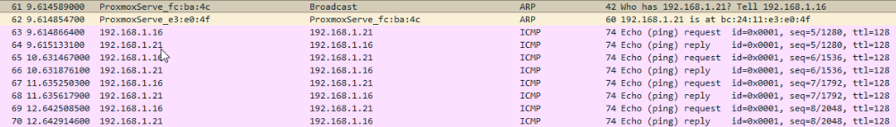
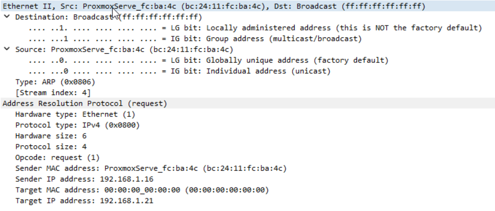
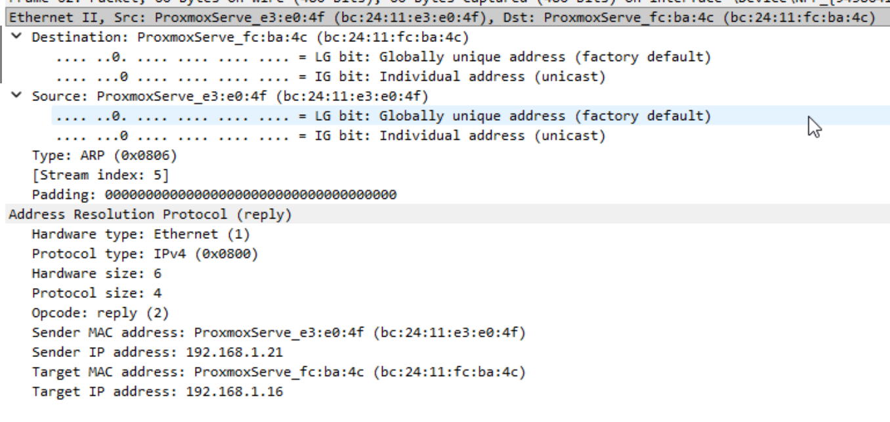
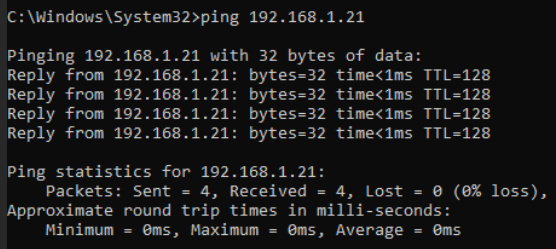

# Lab06 : Analyse de trames ARP avec Wireshark
## 1. Informations Générales
* **Date** : 27/11/2026
* **Outil** : 
    * *View ARP Traffic in Wireshark.html* (Cisco)
    * Wireshark
    * Infrastructure Virtualisée 
        * Hyperviseur T1 : Proxmox VE 9.2.2
        * CPU : I7-7700K (4 coeurs / 8 threads avec Hyper-Threading @4,2 Ghz)
        * RAM : 16 Go DDR4 CL16 (3200 Mhz)
        * Stockage : 1 To SSD NVMe
    * Machines Virtuelles Principales (VM 100 et VM 101)
        * OS : Windows 11 Enterprise (64-bit)
        * vCPU : 4 vCPU 
        * RAM : 4 Go alloués
        * Stockage : 32 Go 
* **Objectifs** : 
    * [Capturer des trames ARP](#21-capture-de-trames--arp)
    * [Analyser des trames ARP](#22-analyse-de-trames-arp)
* **Remarque** : Les informations sensibles tels que l'adresse MAC du routeur sont masquées.
* [Bilan](#3-bilan)

## 2. Étapes
### 2.1. Capture de trames  ARP

* Utiliser la commande `ipconfig /all` sur les deux VMs pour récupérer leurs adresses MAC et IPv4.

| VM   | Adresse MAC       | Adresse IPv4  |
| ---- | ----------------- | ---------------- |
| VM01 | BC-24-11-FC-BA-4C | 192.168.1.16     |
| VM02 | BC-24-11-E3-E0-4F | 192.168.1.21     |

* Lancer Wireshark, filtrer par paquet arp et démarrer la capture de données.
* Ping VM02 `192.168.1.21` puis stopper la capture de données.

### 2.2. Analyse de trames ARP
  
*Trames Ethernet*
  
*Figure 1 : Trame Ethernet requête ARP par VM01*

* Dans la figure 1 nous voyons un message de diffusion `Destination : ff:ff:ff:ff:ff:ff`, à partir de l'adresse MAC de VM01 `Source: bc:24:11:fc:ba:4c` et avec le champ type correspondant à ARP `0x0806`. Ces trois champs servent à acheminer la trame sur le réseau local à partir des adresses physiques source et destination, puis à indiquer au périphérique récepteur comment traiter les données reçues, avec le champ type.
* Avec la section des champs de données encapsulés par l'en-tête précédent `Address Resolution Protocol` nous pouvons préciser le format des adresses utilisées par la trame : `Ethernet (6 bytes)` pour les adresses physiques et `IPv4 (4 bytes)` pour les adresses logiques. Ainsi que l'objectif du message : l'`Opcode : 1` est une requête. Il s'agit bien d'une question posée par VM01 au réseau local afin d'associer l'adresse IPv4 `192.168.1.21` désigné dans `Target IP adress` à une adresse MAC, qui est ici remplis de zéro puisque elle est inconnue `Target MAC address : 00:00:00:00:00:00`.
* Ainsi, la machine VM01 émettrice de cette trame ARP va attendre en retour l'adresse MAC de VM01 avant de lui envoyer un ping. Cette trame de réponse ARP va échanger les adresses physiques et logiques de source et destination, en ajoutant son adresse MAC dans celle de de l'adresse MAC source.
  
*Figure 2 : Trame Ethernet réponse ARP par VM02*
* Le champ de données Opcode `2` et le champ d'en-tête Type `0x0806`confirment qu'il s'agit ici d'une trame de réponse ARP. Les champs d'en-tête `Destination : bc:24:11:e3:e0:4c` (VM01) et `Source : bc:24:11:e3:e0:4f` (VM02) correspondent au comportement attendu précédemment : la réponse est en monodiffusion vers l'émetteur initial et VM02 fournit son adresse MAC dans le champ de données `Sender Mac Address`, qui sera associée à l'adresse IP de l'émetteur `Sender IP address : 192.168.1.21` dans la table ble ARP de VM01.
  
* Une fois l'association faite, VM01 peut maintenant communqiuer directement avec VM02, comme confirmer par la réponse au ping.

## 3. Bilan
Cette analyse a mis en évidence le mécanisme de résolution d'adresse sur un réseau local et m'a également permis d'améliorer ma capacité à repérer les indices importants dans une trame ARP. Notons aussi que ce protocole est vulnérable à l'usurpation (ARP spoofing) s'il n'est pas sécurisé sur les switchs (aspect exploré ultérieurement).