# Lab07 : Analyse des échanges DNS, TCP et HTTP avec Wireshark
## 1. Informations Générales
* **Date** : 28/11/2026
* **Outil** : 
    * Wireshark
    * Infrastructure Virtualisée 
        * Hyperviseur T1 : Proxmox VE 9.2.2
        * CPU : I7-7700K (4 coeurs / 8 threads avec Hyper-Threading @4,2 Ghz)
        * RAM : 16 Go DDR4 CL16 (3200 Mhz)
        * Stockage : 1 To SSD NVMe
    * Machines Virtuelles Principales (VM 100)
        * OS : Windows 11 Enterprise (64-bit)
        * vCPU : 4 vCPU 
        * RAM : 4 Go alloués
        * Stockage : 32 Go 
* **Objectifs** : 
    * [Identifier les adresses du réseau et capturer des trames](#21-identification-des-adresses-du-réseau-et-capture-de-trames)  
    * [Analyser les échanges DNS](#22-analyse-des-échanges-dns)
    * [Analyser les échanges TCP et HTTP](#23-analyse-des-échanges-tcp-et-http)
* **Remarque** : Les informations sensibles tels que l'adresse IPv6 permanente et temporaire du VM01, l'adresse DNS et l'adresse MAC du routeur sont masquées.
* [Bilan](#3-bilan)

## 2. Étapes
### 2.1. Identification des adresses du réseau et capture de trames
IPv6 permanent (connexions entrantes)
IPv6 temporaire (connexions sortantes) 
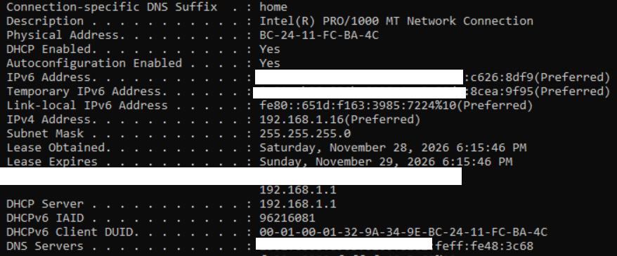  
*Figure 1 : L'ensemble de la configuration IP de VM01 ; quelques addresses masquées par sécurité.*

Utiliser curl pour réduire les bruits de fond réseau
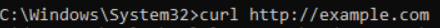  
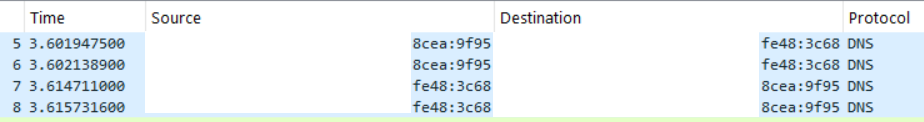  
*Trames capturées du protocole DNS* 

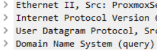   
* Nous voyons ici la pile protocolaire, correspondant à la première trame DNS, avec : 
    * Ethernet II (couche 2, liaison)
    * Internet Protocol Version 6 (couche 3, réseau)
    * User Datagram Protocol (couche 4, transport)
    * Domain Name System (couche 7, application)

### 2.2. Analyse des échanges DNS
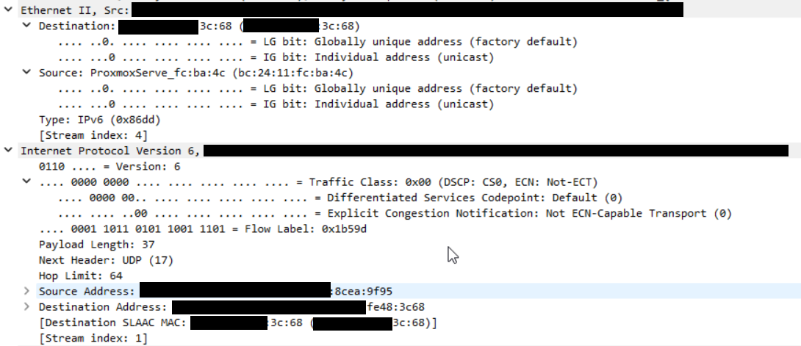   
* On voit que la VM01 (adresse MAC `ba:4c`) envoie localement cette trame au serveur DNS (`3c:68`), qui contient des données de type IPv6 (Type : `0x86dd`).
* Dans le paquet IPv6 désencapsulées on voit qu'il est pour le serveur DNS et que les données sont sous le format UPD.
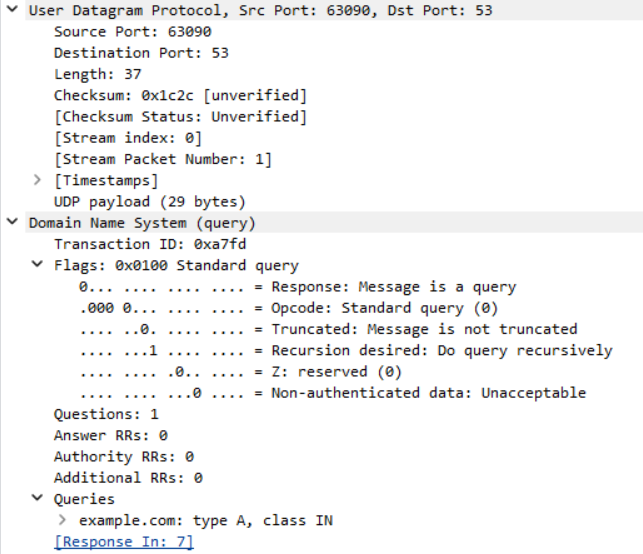  
* Dans le datagramme, le port source de VM01 (aléatoire) est de `63090` et à destination du port 53 qui est réservé à l'application DNS.
* Au niveau des données, le flag Response indique qu'il s'agit d'une question et que la question est une demande de l'adresse IPv4 (type A) associée au nom de domaine example.com.

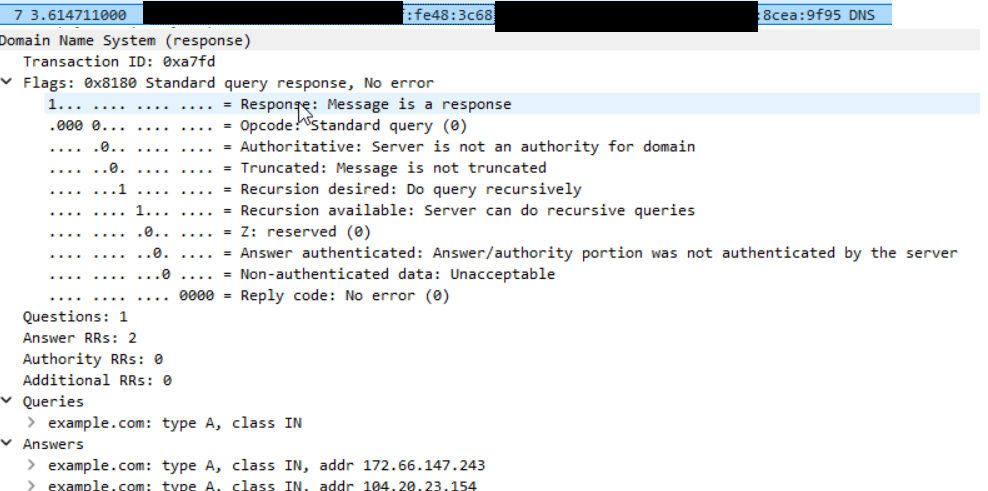  
* Dans la données DNS provenant du serveur DNS, il s'agit de la réponse à la demande précédente. Avec comme réponse que le nom de domaine `example.com` est associé à l'adresse IPv4 : `172.66.147.243` et `104.20.23.154`. VM01 dipose de tout ce qu'il lui faut pour passer à l'étape suivante : ouvrir une connexion TCP sur le port 80.

## 2.3. Analyse des échanges TCP et HTTP
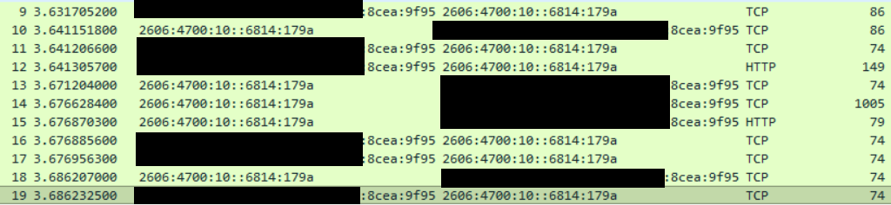  
* Avant d'analyser les trames, on voit déjà le three-way handshake en trame 9, 10 et 11 pour établir la connexion, puis la demande de page web en trame 12.
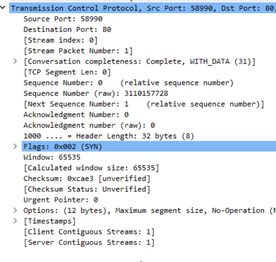  
* Dans le segment TCP, le port 80 nous indique une demande de connexion sur le service HTTP (web) du serveur. En démarrant avec le flag 0x002 (SYN) qui signifie une demande de synchronisation avec le serveur de destination. Qui répondra avec SYN-ACK, puis VM01 enverra une réponse ACK validant l'ouverture de la connexion. En s'aidant du nombre séquentiel, qui est aléatoire afin de sécuriser la connexion.
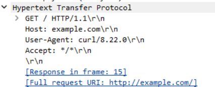  
* Dans les données HTTP de cette trame nous voyons la méthode GET qui demande au serveur de récupérer la page d'accueil (racine) à partir de l'outil curl.
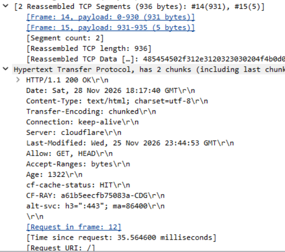  
* L'envoie de la page web c'est fait avec succès en deux trames de deux segments TCP.
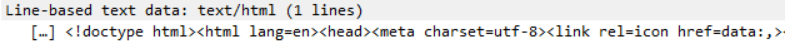  
* Comme le protocole utilisé est HTTP simple (avec curl), les données transférées ne sont pas chiffrées et nous pouvons les lires en texte clair ici. D'où l'importance d'utiliser HTTPS qui chiffre les données transférées afin d'empêcher un attaquant de les examinées ou les modifier.

## 3. Bilan
Ces analyses ont suivi et expliqué l'essentiel du parcours entre la saisie d'une URL et l'affichage d'une page web. Au départ, j'ai utilisé le navigateur Edge pour faire la requête HTTP mais il y avait trop de trames supplémentaires, d'où l'utilisation de curl pour minimiser au maximum. La dernière section a démontré l'importance du chiffrement avec HTTPS.

